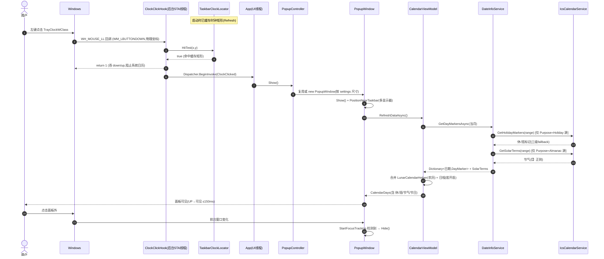
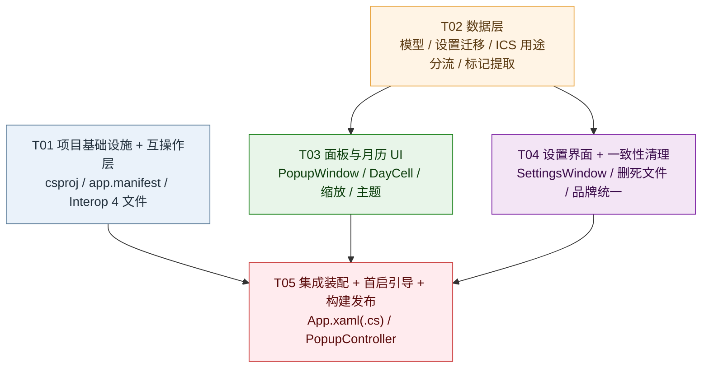

# WinCal 改造 —— 系统架构设计与任务分解

> 作者：架构师 高见远
> 日期：2026-09-16
> 依据（全部已落盘，事实基线，不得推翻）：
> `docs/00-实测发现与决策.md`、`docs/01-PRD.md`、`docs/02-ICS契约实测.md`、`docs/03-决策确认.md`
> 性质：**设计文档**。工程师照此直接实现，无需再探索。本文件**不修改任何源码**。
> 技术栈（硬约束，不变）：`net8.0-windows` + WPF + `CommunityToolkit.Mvvm` 8.3.0 +
> `Ical.Net` 4.3.1 + `Hardcodet.NotifyIcon.Wpf` 2.0.1，**纯 WPF 矢量渲染，不引入任何第三方 UI 框架**。

---

# Part A：系统设计

## 1. 实现方案总览

### 1.1 核心技术难点

| # | 难点 | 应对方案 |
|---|------|---------|
| D1 | **入口不存在可拦截对象**（点时钟不弹任何东西，`SetWinEventHook` 路线作废） | 改用 `WH_MOUSE_LL` 低级鼠标钩子**接管点击**。**回调必须极快（< 1ms）**，因此命中判定只做「已缓存的时钟矩形」比对，不做任何窗口枚举/UIA |
| D2 | **DPI 坐标系错乱**（未感知时钩子物理坐标与 `GetWindowRect` 不在同一坐标系） | 通过 `app.manifest` 声明 **PerMonitorV2** DPI 感知；启动早期再调 `SetProcessDpiAwareness(2)` 兜底。此后全进程统一使用**物理像素**，只在给 WPF 赋值时用 `CompositionTarget.TransformFromDevice` 转 DIP |
| D3 | **`CalendarEvent` 模型不承载 `CATEGORIES` / `X-APPLE-SPECIAL-DAY`**（阻塞 P0-5） | **不往 `CalendarEvent` 加字段**。新建 `DayMarker` 独立通道，从 `Ical.Net` 原始对象直接提取标记；`CalendarEvent` 只服务「日程层」，与「休班标记层」彻底解耦（契约 C10） |
| D4 | **休/班不能关键字瞎猜** | 严格三级 fallback：`DESCRIPTION`(`休`/`班`) → `X-APPLE-SPECIAL-DAY` → `SUMMARY` 括号后缀；三级均判不出→**不打标记**（契约 C1/C6） |
| D5 | **源 B 1.3MB / 1096 事件，翻月重复展开** | `IcsCalendarService` 增加**按月缓存**展开结果；标记提取走 `SUMMARY` 轻量通道，不读长 `DESCRIPTION`（契约 T4-a） |
| D6 | **面板自由缩放与 `SizeToContent` 硬冲突** | 移除 `SizeToContent`、固定 `Height`；**放弃 `WindowChrome`**（与 `AllowsTransparency=True` 组合易出坑），改用**手工缩放**（`PanelResizeHelper`），右下角锚点固定 |
| D7 | **单源用途分流**（Q12） | 订阅配置升级为 `List<IcsSubscription>`（含 `Purpose`）；`DateInfoService` 按用途建源并分流；日程层**只消费 `Purpose=Schedule`** 的源 |
| D8 | **一处改动引发多处编译冲突** | `App.xaml.cs`（装配中枢）**只由最后一个任务 T05 单独拥有**，避免并行修改冲突 |

### 1.2 分层与职责边界

```
┌──────────────────────────────────────────────────────────────────────┐
│ 装配层  App.xaml.cs (T05)                                             │
│   生命周期编排：设置加载→主题→托盘(可选)→钩子→热键→首启引导→退出清理    │
└───────────────┬──────────────────────────────────────────────────────┘
                │ 组装
┌───────────────▼───────────────┐   ┌──────────────────────────────────┐
│ 入口层 Core/Interop (T01)      │   │ 视图层 Views (T03/T04)            │
│  · ClockClickHook  (WH_MOUSE_LL)│   │  · PopupWindow (主面板+缩放)      │
│  · TaskbarClockLocator (命中)  │   │  · MonthCalendar / DayCell       │
│  · GlobalHotkeyService         │   │  · HolidaySummaryBar (P1-1)      │
│  · NativeMethods (P/Invoke集中)│   │  · SettingsWindow (T04)          │
└───────────────┬───────────────┘   └───────────────┬──────────────────┘
                │ 触发 ClockClicked                  │ 绑定
                └──────────────┬─────────────────────┘
                               ▼
                ┌──────────────────────────────┐
                │ ViewModel: CalendarViewModel  │  (T03)
                │  月网格 / 标记 / 节气 / 日程   │
                └──────────────┬───────────────┘
                               ▼
                ┌──────────────────────────────┐
                │ 数据服务层 Core/Services (T02) │
                │  · DateInfoService  按用途分流 │
                │  · IcsCalendarService 解析+标记│
                │  · AppSettings 订阅/迁移      │
                └──────────────┬───────────────┘
                               ▼
        ┌──────────────┬───────────────┬────────────────┐
        ▼              ▼               ▼                ▼
   休班标记层      节气层         农历层(本地)      日程层(默认关)
   DayMarker      SolarTerm      LunarCalendarHelper  CalendarEvent
   (用途=节假日)  (用途=农历节气)  (ChineseLunisolar)  (用途=日程)
```

**关键边界（契约级，工程实现必须遵守）**：
- **休班标记层 ≠ 日程层**：`DayMarker` 与 `CalendarEvent` 是两条独立数据流。关闭日程开关 **不影响**休班标记（P0-6 核心判断 / C10）。
- **农历 = 本地推算**（`LunarCalendarHelper`，全时段覆盖）；**节气 = ICS**（`【】` 提取，超订阅年限则不显示、不回退寿星公式，Q2/C6）。
- **入口层不碰业务**：`ClockClickHook` 只负责「判定命中 → 抛事件」，弹面板、渲染全在装配层与视图层。

### 1.3 框架与库选型

技术栈不变，**本次不新增任何第三方包**（见 Part B §6）。复用现有能力，明确**不重复造轮子**：

| 能力 | 现有承担者 | 本次处置 |
|------|-----------|---------|
| ICS 解析 / fold 展开 / `\n` 反转义 | `Ical.Net` `Calendar.Load()` | **直接复用**（契约 T2 / A4） |
| `DTEND` 排他语义 | `Ical.Net` period + 现有 `-1 天` 处理 | **直接复用**（契约 T1 / A3） |
| 内存+磁盘双层缓存、多源隔离（`{url_hash}.ics`） | `IcsCalendarService` | 复用，仅补**按月展开缓存**与**缓存体积治理**接口 |
| 农历 | `LunarCalendarHelper` | 复用，作为农历唯一来源 |
| 主题切换 / 托盘动态图标 / 焦点丢失自动关闭 | `ThemeHelper` / `TrayIconGenerator` / `PopupWindow.StartFocusTracking` | **保留，不重构**（00 文档 §5 九项优点） |

**架构模式**：沿用 **MVVM**（`CommunityToolkit.Mvvm` 已在栈内；但现有 `CalendarViewModel` 手写 `INotifyPropertyChanged`，**为降低回归风险，本次沿用现有手写式，不强制改写为 `[ObservableProperty]`**）。View 层通过 `DataContext` 绑定 VM，事件经 `ICommand`/CLR 事件回调。

---

## 2. 文件列表

> 路径均相对仓库根 `E:\我的工作\罗晓晨工作\codes\wincal\`。图例：**[新]** 新增、**[改]** 修改、**[删]** 删除、**[留]** 不动。

### 2.1 新增文件

| 路径 | 说明 | 归属任务 |
|------|------|---------|
| `app.manifest` | **DPI 感知清单**（PerMonitorV2），解决 D2。由 `WinCal.csproj` 的 `<ApplicationManifest>` 引用 | T01 |
| `Core/Interop/NativeMethods.cs` | 集中所有 Win32 P/Invoke 声明（钩子/热键/窗口/显示器）。**单一来源**，避免签名散落 | T01 |
| `Core/Interop/ClockClickHook.cs` | `WH_MOUSE_LL` 鼠标钩子服务；后台 STA 线程 + 消息循环；命中即抛 `ClockClicked` | T01 |
| `Core/Interop/TaskbarClockLocator.cs` | 时钟命中判定与**矩形缓存**；Win10 类名枚举 / Win11 UIA（失败即放弃，不猜测） | T01 |
| `Core/Interop/GlobalHotkeyService.cs` | 全局快捷键（`Ctrl+Alt+C`），注册失败**显式上报**（Q8） | T01 |
| `Core/Models/DayMarker.cs` | **休班标记模型**（`DayKind` + 名称）；`HolidayMarkerRaw`（解析中间态，支持多值 C4） | T02 |
| `Core/Models/AlmanacInfo.cs` | 黄历数据（宜/忌/冲煞/干支/建除/二十八宿/月相）**P2 数据预留**（C11） | T02 |
| `Core/Services/IcsSubscription.cs` | 订阅配置项（`Url/Alias/Purpose/Enabled`）+ `IcsPurpose` 枚举（Q12/C12） | T02 |
| `Core/Services/DateInfoService.cs` | **按用途分流**的日期信息服务；产出 `DayMarker`/`SolarTerm`/`Almanac`/日程事件；数据源诚实状态 | T02 |
| `Core/Services/DataSourceStatus.cs` | 「系统日历不可用」等诚实横幅的状态模型（P0-8 / Q3） | T02 |
| `Core/Helpers/PanelResizeHelper.cs` | 手工缩放引擎（热区判定 + 锚点固定 + 边界钳制）（D6） | T03 |
| `Views/Controls/HolidaySummaryBar.xaml(.cs)` | **P1-1 当月放假速览条** | T03 |
| `Views/Themes/Metrics.Compact.xaml` | 紧凑档（<380）字号/尺寸资源字典（P1-4） | T03 |
| `Views/Themes/Metrics.Standard.xaml` | 标准档（380–479，默认） | T03 |
| `Views/Themes/Metrics.Wide.xaml` | 宽松档（≥480） | T03 |
| `Core/Services/FirstRunService.cs` | 首启引导/自启询问状态管理（Q6/Q7，P1-6） | T05 |
| `Core/Services/PopupController.cs` | 面板显隐/切换/定位/尺寸持久化编排（装配层依赖） | T05 |

### 2.2 修改文件

| 路径 | 修改要点 | 归属任务 |
|------|---------|---------|
| `WinCal.csproj` | 增加 `<ApplicationManifest>app.manifest</ApplicationManifest>`；**不得**加回 `PublishTrimmed`；不得引入新包 | T01 |
| `Core/Models/CalendarDay.cs` | 扩展渲染聚合字段：`MarkKind`/`HolidayName`/`SolarTerm`/`LunarFestival`/`Almanac` | T02 |
| `Core/Services/AppSettings.cs` | 数据目录统一 `%LOCALAPPDATA%\WinCal`；`miniCal` 一次性迁移；新增 12 项设置；`IcsSubscription` 列表；周起始默认周一 | T02 |
| `Core/Services/IcsCalendarService.cs` | 构造改吃 `IcsSubscription`；新增 `GetHolidayMarkers/GetSolarTerms/GetAlmanac`；按月缓存；`User-Agent`→`WinCal/1.0` | T02 |
| `Core/Services/MockCalendarService.cs` | 仅由 `UseMockData=true` 触发；加 `[Obsolete]` 注释说明「禁止默认启用」 | T02 |
| `ViewModels/CalendarViewModel.cs` | 依赖改为 `DateInfoService`；`WeekStartDay` 单一数据源；合并标记/节气/农历；日程开关三态；Header 时间文本；横幅/引导文本 | T03 |
| `Views/PopupWindow.xaml(.cs)` | **整体重做**：Header(44)+周头(24)+月历+日程三态区；移除 `SizeToContent`；尺寸 420×620/最小 320×420；缩放；抓手 | T03 |
| `Views/Controls/MonthCalendar.xaml(.cs)` | 导航上移到 Header；保留周头 + 6×7 网格；`Band` 绑定新字段 | T03 |
| `Views/Controls/DayCell.xaml(.cs)` | 重做：休班底色+胶囊+节日名+节气色+今日圆 30px+事件点；三档字号 | T03 |
| `Views/Themes/Light.xaml` / `Views/Themes/Dark.xaml` | 新增休/班/节气/农历节日/胶囊/周末 等画刷（含 P0-5 精确色值） | T03 |
| `Views/SettingsWindow.xaml(.cs)` | 新增「用途」下拉、托盘开关、日程开关、快捷键、模拟数据开关；「系统日历」标注不可用；退出入口；文案统一 `WinCal` | T04 |
| `Core/Helpers/StartupHelper.cs` | 注册表值名 `miniCal`→`WinCal`；兼容读取/清理旧值 | T04 |
| `App.xaml` | 托盘资源默认 `Visibility="Collapsed"`；ToolTip 改 `WinCal` | T05 |
| `App.xaml.cs` | 装配中枢：卸载 `SystemCalendarInterceptor` 改为钩子/热键；托盘按设置显隐；首启引导；退出清理（`UnhookWindowsHookEx`） | T05 |
| `Views/Controls/EventItem.xaml(.cs)` | 文案/样式随新配色微调（**保留** hover 详情、颜色条、去重圆点能力） | T04 |

### 2.3 删除文件

| 路径 | 理由 |
|------|------|
| `Core/Helpers/SystemCalendarInterceptor.cs` | **[删]** 实测证明本机点时钟不弹任何窗口，`SetWinEventHook` 路线**无对象可拦**（00 §2.1）。它在本机**永远不工作**，保留 = 死代码 + 误导后人（P0-1 / P0-10#6）。git 保留历史，无需留档 |
| `Views/Controls/EventDetailPopup.xaml` / `.xaml.cs` | **[删]** `PROGRESS.md` 已标注弃用（00 §4#6）。改用 `EventDetailWindow`，删除死文件（P0-10#5） |

**保留但停用（不是删除）**：
- `Core/Services/WindowsCalendarService.cs`：**继续**被 `<Compile Remove>` 排除（`WinCal.csproj:31`，改回会因缺 Win10 SDK 编译失败）。其「不可用」事实改由 **UI 诚实标注 + 面板横幅**呈现（P0-8 / Q3）。
- `Core/Services/AggregateCalendarService.cs`、`ICalendarService.cs`、`EmptyCalendarService.cs`：**保留**，作为 `DateInfoService` 内部的日程层实现（G6 功能保留）。

---

## 3. 数据结构与接口（类图）

```mermaid
classDiagram
    direction LR

    %% ============ 配置层 ============
    class AppSettings {
        +ThemeMode ThemeMode
        +int FontSizeOffset
        +bool AutoStartup
        +bool AutoStartupAsked
        +DataSourceType DataSource
        +List~IcsSubscription~ Subscriptions
        +int IcsRefreshMinutes
        +bool ShowTrayIcon
        +bool EnableSchedule
        +bool ScheduleExpanded
        +double PanelWidth
        +double PanelHeight
        +string Hotkey
        +bool UseMockData
        +bool FirstRunNoticeShown
        +WeekStartDay WeekStartDay
        +bool ShowHeaderDateTime
        +TimeFormatMode TimeFormat
        +int UpcomingDays
        +static AppSettings Load()
        +void Save()
        +void MigrateLegacy()
    }
    class IcsSubscription {
        +string Url
        +string Alias
        +IcsPurpose Purpose
        +bool Enabled
    }
    class IcsPurpose {
        <<enumeration>>
        Holiday
        Almanac
        Schedule
    }
    class DataSourceType {
        <<enumeration>>
        SystemCalendar
        IcsUrl
        Both
    }
    class WeekStartDay {
        <<enumeration>>
        Sunday
        Monday
    }
    class TimeFormatMode {
        <<enumeration>>
        FollowSystem
        Hour12
        Hour24
    }

    %% ============ 模型层 ============
    class DayKind {
        <<enumeration>>
        None
        Holiday
        Workday
    }
    class DayMarker {
        +DateTime Date
        +DayKind Kind
        +string Name
    }
    class HolidayMarkerRaw {
        +DateTime Date
        +DayKind Kind
        +string Name
        +string SourceName
        +string Evidence
    }
    class SolarTerm {
        +DateTime Date
        +string Name
    }
    class AlmanacInfo {
        +string? GanZhi
        +string? Yi
        +string? Ji
        +string? ChongSha
        +string? JianChu
        +string? Xiu
        +string? MoonPhase
    }
    class CalendarEvent {
        +string Title
        +DateTime StartTime
        +DateTime EndTime
        +bool IsAllDay
        +string CalendarName
        +string Color
        +string? Location
        +string? Description
    }
    class CalendarDay {
        +DateTime Date
        +bool IsCurrentMonth
        +bool IsToday
        +bool HasEvents
        +string LunarDate
        +DayKind MarkKind
        +string? HolidayName
        +string? SolarTerm
        +string? LunarFestival
        +AlmanacInfo? Almanac
        +List~CalendarEvent~ Events
    }

    %% ============ 服务层 ============
    class DateInfoService {
        -List~IcsCalendarService~ _holidaySources
        -List~IcsCalendarService~ _almanacSources
        -List~IcsCalendarService~ _scheduleSources
        +DateInfoService(AppSettings settings)
        +Task~Dictionary~DateTime,DayMarker~~ GetDayMarkersAsync(DateTime start, DateTime end)
        +Task~Dictionary~DateTime,string~~ GetSolarTermsAsync(DateTime start, DateTime end)
        +Task~Dictionary~DateTime,AlmanacInfo~~ GetAlmanacAsync(DateTime start, DateTime end)
        +Task~List~CalendarEvent~~ GetScheduleEventsAsync(DateTime start, DateTime end)
        +Task~DataSourceStatus~ GetDataSourceStatusAsync()
        +Task ForceRefreshAsync()
    }
    class IcsCalendarService {
        -IcsSubscription _sub
        -Calendar _cachedCalendar
        -Dictionary~string,object~ _monthCache
        +IcsCalendarService(IcsSubscription, int refreshMinutes, string color)
        +Task~List~CalendarEvent~~ GetEventsAsync(DateTime start, DateTime end)
        +List~HolidayMarkerRaw~ GetHolidayMarkers(DateTime start, DateTime end)
        +List~SolarTerm~ GetSolarTerms(DateTime start, DateTime end)
        +List~AlmanacInfo~ GetAlmanac(DateTime start, DateTime end)
        +Task~bool~ IsAvailableAsync()
        +Task ForceRefreshAsync()
        +void OpenSystemCalendarApp()
    }
    class ICalendarService {
        <<interface>>
        +Task~List~CalendarEvent~~ GetEventsAsync(DateTime, DateTime)
        +Task~bool~ IsAvailableAsync()
        +Task ForceRefreshAsync()
    }
    class DataSourceStatus {
        +bool IsSystemCalendarUnavailable
        +string? BannerText
        +string DataSourceLabel
    }

    %% ============ 入口/互操作层 ============
    class ClockClickHook {
        -IntPtr _hook
        -NativeMethods.LowLevelMouseProc _proc
        -Thread _thread
        -bool _suppressUp
        +event Action~int,int~ ClockClicked
        +bool IsRunning
        +void Start()
        +void Stop()
        +void Dispose()
        -IntPtr HookProc(int nCode, IntPtr wParam, IntPtr lParam)
    }
    class TaskbarClockLocator {
        -List~ClockRegion~ _cache
        +bool HitTest(int x, int y)
        +void Refresh()
        +static List~ClockRegion~ EnumerateClockRects()
    }
    class ClockRegion {
        +NativeMethods.RECT Rect
        +IntPtr Monitor
    }
    class GlobalHotkeyService {
        -HwndSource _source
        +event Action Pressed
        +event Action~string~ RegistrationFailed
        +bool Register(string hotkey, Window owner)
        +void Unregister()
    }
    class NativeMethods {
        <<static>>
        +const int WH_MOUSE_LL
        +const int WM_LBUTTONDOWN
        +const int WM_LBUTTONUP
        +SetWindowsHookExW()
        +CallNextHookEx()
        +UnhookWindowsHookEx()
        +WindowFromPoint()
        +GetClassNameW()
        +GetWindowRect()
        +EnumChildWindows()
        +RegisterHotKey()
        +UnregisterHotKey()
        +SetProcessDpiAwareness()
    }

    %% ============ 视图/VM 层 ============
    class CalendarViewModel {
        +int Year
        +int Month
        +string MonthDisplay
        +DateTime SelectedDate
        +int WeekStartDay
        +bool EnableSchedule
        +bool ScheduleExpanded
        +string HeaderTimeText
        +string? BannerText
        +string? HolidaySummaryText
        +ObservableCollection~CalendarDay~ CalendarDays
        +ObservableCollection~CalendarEvent~ UpcomingEvents
        +Task RefreshDataAsync()
        +void NavigatePreviousMonth()
        +void NavigateNextMonth()
        +void NavigateToToday()
        +void SelectDate(DateTime)
        +void ToggleSchedule()
    }
    class PopupController {
        +void Show()
        +void Toggle()
        +void Hide()
        +void SavePanelSize(double w, double h)
    }
    class PanelResizeHelper {
        <<static>>
        +void Attach(Window win, double minW, double minH, Action~double,double~ onCommit)
        +PanelResizeZone HitZone(Point p, Size s)
    }
    class PanelResizeZone {
        <<enumeration>>
        None
        Left
        Right
        Top
        Bottom
        TopLeft
        TopRight
        BottomLeft
        BottomRight
    }

    %% ============ 关系 ============
    AppSettings "1" *-- "*" IcsSubscription : Subscriptions
    IcsSubscription --> IcsPurpose
    AppSettings --> DataSourceType
    AppSettings --> WeekStartDay
    AppSettings --> TimeFormatMode

    DateInfoService "1" o-- "*" IcsCalendarService : 按用途分组持有
    IcsCalendarService ..> CalendarEvent : 日程层
    IcsCalendarService ..> HolidayMarkerRaw : 休班标记层
    IcsCalendarService ..> SolarTerm : 节气层
    IcsCalendarService ..> AlmanacInfo : P2 预留
    IcsCalendarService ..|> ICalendarService
    DateInfoService ..> DayMarker : 归并多值(C4)
    DateInfoService ..> DataSourceStatus

    DayMarker --> DayKind
    HolidayMarkerRaw --> DayKind
    CalendarDay --> DayKind
    CalendarDay o-- "*" CalendarEvent : Events
    CalendarDay ..> AlmanacInfo

    CalendarViewModel --> DateInfoService
    CalendarViewModel "1" *-- "*" CalendarDay
    PopupController --> CalendarViewModel
    PanelResizeHelper ..> PanelResizeZone

    ClockClickHook --> TaskbarClockLocator
    TaskbarClockLocator "1" *-- "*" ClockRegion
    ClockClickHook ..> NativeMethods
    GlobalHotkeyService ..> NativeMethods
```



### 3.1 关键接口签名（工程师照抄）

**休班标记三级 fallback（`IcsCalendarService.GetHolidayMarkers` 内部）**

```csharp
// 对范围内每个 occurrence：
//   1) 依 DTSTART..DTEND-1 展开覆盖的每一天（DTEND 排他，C3）
//   2) 逐日判定：
//      L1: Description 去空白后恰为 "休" / "班"
//      L2: X-APPLE-SPECIAL-DAY == "WORK-HOLIDAY" -> 休；"ALTERNATE-WORKDAY" -> 班
//      L3: Summary 正则 \(([休班])\)$
//      三级皆失败 -> 丢弃（不打标记，C1/C6）
//   3) 同名前缀去重（复用现有 Split('（','(')[0] 策略），但保留 Kind 不同者
//   4) 输出 List<HolidayMarkerRaw>，同一天可多条（C4）
static DayKind ResolveKind(string? description, string? appleSpecialDay, string? summary);
private static readonly Regex SummarySuffixRegex = new(@"\(([休班])\)\s*$");
```

**节气提取（`GetSolarTerms`）**

```csharp
private static readonly Regex SolarTermRegex = new(@"【([^】]+)】");
// SUMMARY 命中【】即节气日；无则非节气。不维护 24 节气名表（C5）。
// 超出订阅覆盖年份 -> 返回空集（不报错、不回退、不猜，C6/Q2）。
```

**命中判定（`TaskbarClockLocator`）**

```csharp
public bool HitTest(int x, int y)          // 仅遍历 _cache（≤3 条），O(1)~O(3)
public static List<ClockRegion> EnumerateClockRects();
//  Win10 路径：FindWindowW("Shell_TrayWnd"/"Shell_SecondaryTrayWnd")
//             → EnumChildWindows 收集 GetClassNameW=="TrayClockWClass" 的 GetWindowRect
//  Win11 路径：taskbar 无独立时钟窗口 → 用 UI Automation 找 AutomationId=="ClockButton"
//             的 Text 元素矩形；**UIA 定位失败即放弃**（返回空表，不加几何兜底）。
//             理由：现代任务栏中时钟紧贴「通知区」（TrayButton）而非紧贴任务栏右缘，
//             以「右缘内缩固定像素 + 固定宽度」得到的条带必然覆盖通知中心，
//             一旦命中通知中心就会被钩子吞掉点击、导致通知中心打不开。
//             宁可漏判（用户仍有 Ctrl+Alt+C 热键兜底），也绝不误吞系统功能。
//             （本机不可验证，见 §5 待明确 U1）
public void Refresh();                     // 显示器/设置变化时重算；否则 30s 周期刷新
```

**钩子回调（`ClockClickHook.HookProc` 伪码，性能关键）**

```csharp
private IntPtr HookProc(int nCode, IntPtr wParam, IntPtr lParam)
{
    if (nCode < 0) return NativeMethods.CallNextHookEx(_hook, nCode, wParam, lParam);
    int msg = (int)wParam;
    if (msg == NativeMethods.WM_LBUTTONDOWN)
    {
        var ms = Marshal.PtrToStructure<NativeMethods.MSLLHOOKSTRUCT>(lParam);
        if (_locator.HitTest(ms.pt.X, ms.pt.Y))   // ← 只比对缓存矩形，无枚举/UIA
        {
            _suppressUp = true;
            _onUi(() => ClockClicked?.Invoke(ms.pt.X, ms.pt.Y)); // Dispatcher.BeginInvoke
            return (IntPtr)1;                      // 吞掉本次 down（阻止系统日历弹出）
        }
    }
    else if (msg == NativeMethods.WM_LBUTTONUP && _suppressUp)
    {
        _suppressUp = false;
        return (IntPtr)1;                          // 吞掉配对 up，避免系统收到半次点击
    }
    return NativeMethods.CallNextHookEx(_hook, nCode, wParam, lParam); // 未命中一律放行
}
```

**缩放引擎（`PanelResizeHelper`）**

```csharp
public static void Attach(Window win, double minW, double minH, Action<double, double> onCommit);
//  - 热区：四边 6 DIP、四角 10×10（PanelResizeZone）
//  - 拖动左/上边：Left/Top 与 Width/Height 同改（右/下边界固定 → 贴任务栏）
//  - 拖动右/下边：仅改 Width/Height（左/上固定），并钳制不越工作区
//  - 钳制：W∈[minW, work.W-16], H∈[minH, work.H-16]
//  - onCommit：移动结束后 500ms 防抖回调，用于写 settings（P0-3 验收 4）
```

---

## 4. 程序调用流程（时序图）

### 4.1 时序①：点任务栏时钟 → 钩子命中 → 弹面板 → 渲染休班/节气



### 4.2 时序②：启动 → 加载订阅 → 按用途分流 → 缓存

```mermaid
sequenceDiagram
    autonumber
    participant APP as App.OnStartup
    participant ST as AppSettings
    participant HK as ClockClickHook
    participant GH as GlobalHotkeyService
    participant DIS as DateInfoService
    participant ICS as IcsCalendarService
    participant DISK as 磁盘缓存
    participant NET as 网络

    APP->>ST: Load()
    ST->>ST: MigrateLegacy(): miniCal 目录->WinCal(备份 miniCal.bak)
    ST->>ST: IcsUrls/IcsAliases -> Subscriptions(Purpose 默认 Holiday)
    ST-->>APP: settings(含 Subscriptions[用途])
    APP->>APP: ThemeHelper.ApplyTheme(); 托盘按 ShowTrayIcon 显隐
    APP->>HK: Start()(SetWindowsHookExW WH_MOUSE_LL)
    APP->>GH: Register("Ctrl+Alt+C", owner)
    alt 注册失败
        GH-->>APP: RegistrationFailed("快捷键被占用…") (Q8 不静默)
    end
    APP->>DIS: new DateInfoService(settings) 按 Purpose 分组
    DIS->>ICS: new IcsCalendarService(每条订阅, 用途, 颜色)
    APP->>DIS: GetDayMarkersAsync(当月) 预热
    loop 每个 用途=Holiday/Almanac 源
        ICS->>DISK: 读 {url_hash}.ics
        alt 磁盘命中且未过期
            DISK-->>ICS: ICS 文本
        else 无缓存/过期
            ICS->>NET: GET (User-Agent: WinCal/1.0)
            NET-->>ICS: ICS 文本
            ICS->>DISK: 写缓存(含体积治理)
        end
        ICS->>ICS: Calendar.Load()(自动 unfold/反转义)
        ICS->>ICS: 提取 标记/节气/黄历(按月缓存)
        ICS-->>DIS: 标记/节气
    end
    DIS-->>APP: 就绪(不阻塞面板弹出)
```

---

## 5. 待明确事项与假设

> `docs/03` 已裁定 12 项，**不重复询问**。以下为设计层面**新增**的假设/开放点。

| # | 事项 | 我的假设（工程默认按此实现） | 风险等级 |
|---|------|------------------------------|---------|
| **U1** | **Win11 原生任务栏时钟命中判定**（用户可能卸载 ExplorerPatcher） | 本机装了 EP，**Win11 XAML 任务栏路径无法在本机验证**。默认按「UIA `ClockButton` 定位，**失败即放弃（不猜测条带）**」实现；命中失败**必须放行**，快捷键 `Ctrl+Alt+C` 为兜底入口。依据：2026-09-18 实测本机任务栏 `TrayClockWClass=(2430,1400,2507,1440)`、`TrayButton=(2507,1400,2555,1440)`，按旧几何条带 `(2448→2548)` 右端会压住通知中心，造成误吞系统功能的点击 | 中 |
| **U2** | **命中时是否吞掉点击** | 采用「命中即吞 down+up」。理由：Win11 原生下点时钟会弹系统日历，若不吞会出现**双面板**；Win10+EP 下本就无弹窗，吞掉无副作用。未命中一律放行（P0-1 验收 2 保证 0 误弹） | 中 |
| **U3** | `SystemCalendarInterceptor.cs` 处置 | **删除**（理由见 §2.3）。若团队希望留痕，可改为 `.deleted-YYYYMMDD` 但不参与编译——**本设计推荐直接删除** | 低 |
| **U4** | `CalendarDay` 扩展而非新建 `DayInfo` | 为最小化改动，直接扩展 `CalendarDay`（它是**渲染聚合**，非数据模型，不违反 C10） | 低 |
| **U5** | 面板位置固定贴任务栏右下角（Q5 不做拖动） | 缩放时**右下角锚点固定**；不实现拖动。多显示器用 `MonitorFromWindow` | 低 |
| **U6** | 缓存体积治理具体阈值 | 接口预留 `TrimCache()`；默认「单文件 > 2MB 或目录 > 10 个文件时清理最旧」；设置页可「清空缓存」 | 低 |

---

# Part B：任务分解

## 6. 依赖包（Required Packages）

**本次不新增任何第三方包。** 理由：
- 入口用系统 `user32.dll`/`kernel32.dll`/`shcore.dll`（P/Invoke，无需包）；
- 数据用既有 `Ical.Net` 4.3.1；UI 用 WPF 原生；MVVM 用既有 `CommunityToolkit.Mvvm` 8.3.0；托盘用既有 `Hardcodet.NotifyIcon.Wpf` 2.0.1。
- 引入任何新 UI/工具包都**违反 PRD §8「不引入第三方 UI 框架」**。

现有包（保持不变，仅校准版本写法）：

```
- CommunityToolkit.Mvvm@8.3.0 : MVVM 基础（保留）
- Ical.Net@4.3.1              : ICS 解析 + fold/反转义 + DTEND 语义（核心复用）
- Hardcodet.NotifyIcon.Wpf@2.0.1 : 托盘图标（默认隐藏，设置可开）
```

`WinCal.csproj` 唯一改动：新增 `<ApplicationManifest>app.manifest</ApplicationManifest>`；
**禁止**加回 `PublishTrimmed`（会破坏 WPF 反射与钩子委托）；**不得**改动 `build*.bat`/`publish.bat` 的 dotnet 自动探测。

---

## 7. 任务列表（按依赖顺序，共 5 个）

> 硬约束对齐：**总数 ≤ 5** ✅；每任务 **≥ 3 个文件** ✅；第一个任务是**项目基础设施** ✅；
> 无长线性依赖链（T03/T04 仅依赖 T02，T05 汇聚）✅；**不按单文件拆分** ✅。

### T01 — 项目基础设施 + 入口互操作层（P0）

| 项 | 内容 |
|----|------|
| **目标** | 打通「点时钟弹面板」的**一切系统级前提**：DPI 感知、P/Invoke 单一来源、鼠标钩子、命中判定、全局热键 |
| **源文件** | `WinCal.csproj` [改]、`app.manifest` [新]、`Core/Interop/NativeMethods.cs` [新]、`Core/Interop/ClockClickHook.cs` [新]、`Core/Interop/TaskbarClockLocator.cs` [新]、`Core/Interop/GlobalHotkeyService.cs` [新] |
| **依赖** | 无 |
| **优先级** | P0 |
| **验收锚点** | P0-1（钩子命中/放行、退出卸载）、P0-9（热键）、D2（DPI）、§3.1 三坑（DPI/`CallNextHookEx` 签名/消息循环） |
| **关键约束** | `CallNextHookEx`/`SetWindowsHookExW` 用 `IntPtr` 显式签名；钩子委托存字段防 GC；后台 STA 线程 + `GetMessage` 泵；命中失败**必须放行**；`SetProcessDpiAwareness(2)` 在 WPF 初始化前调用 + 清单双保险 |

### T02 — 数据层：模型 + 设置迁移 + ICS 用途分流 + 标记提取（P0）

| 项 | 内容 |
|----|------|
| **目标** | 建立**休班标记层 / 节气层 / 日程层**三条解耦数据流；完成设置目录统一与用途配置 |
| **源文件** | `Core/Models/DayMarker.cs` [新]、`Core/Models/AlmanacInfo.cs` [新]、`Core/Models/CalendarDay.cs` [改]、`Core/Services/IcsSubscription.cs` [新]、`Core/Services/DataSourceStatus.cs` [新]、`Core/Services/DateInfoService.cs` [新]、`Core/Services/AppSettings.cs` [改]、`Core/Services/IcsCalendarService.cs` [改]、`Core/Services/MockCalendarService.cs` [改] |
| **依赖** | 无（与 T01 并行安全：不共享文件） |
| **优先级** | P0 |
| **验收锚点** | P0-5、P0-6、P0-8、P0-10#2/#4、契约 C1–C12、T3/T4/T5/T6 |
| **关键约束** | 三级 fallback 严格实现；`CATEGORIES` 禁用于区分；`DTEND-1`；同日多值；`User-Agent`→`WinCal/1.0`；按月缓存；目录 `%LOCALAPPDATA%\WinCal` + `miniCal` 迁移；周起始默认周一且单一数据源；`Mock` 仅显式开关触发 |

### T03 — 面板与月历 UI：重做布局 + 三态日程 + 缩放 + 主题（P0/P1）

| 项 | 内容 |
|----|------|
| **目标** | 落地「日期工具向」界面：月历为主体、休/班标记可见、面板自由缩放并记忆 |
| **源文件** | `Views/PopupWindow.xaml(.cs)` [改]、`Views/Controls/MonthCalendar.xaml(.cs)` [改]、`Views/Controls/DayCell.xaml(.cs)` [改]、`Views/Controls/HolidaySummaryBar.xaml(.cs)` [新]、`ViewModels/CalendarViewModel.cs` [改]、`Core/Helpers/PanelResizeHelper.cs` [新]、`Views/Themes/Light.xaml` [改]、`Views/Themes/Dark.xaml` [改]、`Views/Themes/Metrics.{Compact,Standard,Wide}.xaml` [新] |
| **依赖** | **T02**（需要 `DayMarker`/`CalendarDay`/`DateInfoService`） |
| **优先级** | P0（缩放/标记/布局）+ P1（速览条/响应式/周末弱区分） |
| **验收锚点** | P0-3、P0-4、P0-5、P1-1、P1-3、P1-4、§6.6 尺寸表、G2/G3 |
| **关键约束** | 移除 `SizeToContent`；默认 420×620、最小 320×420；右下角锚点固定；缩写 `WindowChrome` 方案改手工缩放；保留 9 项优点（今日高亮/非当月灰显/主题跟随/圆角/ClipToBounds） |

### T04 — 设置界面 + 一致性清理（P0）

| 项 | 内容 |
|----|------|
| **目标** | 设置项对齐 12 项决策；清除 `miniCal` 品牌与死文件 |
| **源文件** | `Views/SettingsWindow.xaml(.cs)` [改]、`Core/Helpers/StartupHelper.cs` [改]、`Views/Controls/EventItem.xaml(.cs)` [改]、`Core/Helpers/SystemCalendarInterceptor.cs` [删]、`Views/Controls/EventDetailPopup.xaml(.cs)` [删] |
| **依赖** | **T02**（需要 `IcsSubscription`/新设置字段） |
| **优先级** | P0 |
| **验收锚点** | P0-2、P0-7、P0-8、P0-10#1/#3/#5/#6、Q3/Q8/Q9/Q10/Q12、设置项变更清单 §5.4 |
| **关键约束** | 设置里「系统日历」标注**本机不可用**（绝不静默降级）；新增用途下拉/托盘开关/日程开关/快捷键/模拟数据开关；托盘隐藏时退出入口在设置内；实现 `ShowHeaderDateTime`/`TimeFormat`；注册表值名 `WinCal`（兼容旧 `miniCal`） |

### T05 — 集成装配 + 首启引导 + 构建发布不回归（P0/P1）

| 项 | 内容 |
|----|------|
| **目标** | 把所有部件装配为可运行程序；首启引导；通过发布验收 |
| **源文件** | `App.xaml` [改]、`App.xaml.cs` [改]、`Core/Services/PopupController.cs` [新]、`Core/Services/FirstRunService.cs` [新]、`Views/Themes/…`（如需补文案资源）、`WinCal.csproj`（仅复核，不改探测逻辑） |
| **依赖** | **T01、T03、T04** |
| **优先级** | P0 + P1-6 |
| **验收锚点** | P0-1（装配/卸载）、P0-2（托盘默认隐藏）、P0-9（热键独立于钩子）、P0-11（发布不回归）、P1-6（首启提示含快捷键）、Q6/Q7 |
| **关键约束** | `App.xaml.cs` **唯一拥有者**（避免并行冲突）；退出时 `UnhookWindowsHookEx` + `UnregisterHotKey` + 卸载托盘；首启提示条含 `Ctrl+Alt+C` 与自启询问（可合并为一条）；发布命令**不得**含 `PublishTrimmed` |

---

## 8. 共享知识（跨文件约定，工程师必读）

**① 命名与品牌**
- 程序名、窗口标题、托盘 Tooltip、注册表值名、退出文案、`User-Agent`：统一 **`WinCal`**。全项目 `grep -ri minical` 必须零结果（P0-10#1）。
- 数据目录：`%LOCALAPPDATA%\WinCal\`（设置 `settings.json`、缓存 `cache\{url_hash}.ics`）。

**② DPI 与坐标系（D2，最易踩坑）**
- 进程级：`app.manifest` 声明 **PerMonitorV2**；`App.OnStartup` 最早处再调 `SetProcessDpiAwareness(2)` 兜底。
- 钩子回调 / `GetWindowRect` / `WindowFromPoint` → **物理像素**，三者一致，可直接比较。
- 仅当把坐标交给 WPF（`Window.Left/Top`）时才转 DIP：`dip = px * source.CompositionTarget.TransformFromDevice.M11`（沿用 `WindowPositionHelper` 现有写法）。

**③ `CallNextHookEx` / 钩子委托签名约定（§3.1 坑）**
- `NativeMethods` 中所有指针型参数用 `IntPtr`（**不要**用 `long`/`int`，避免 64 位溢出）。
- `LowLevelMouseProc` 委托实例**必须用字段持有**（`_proc`），否则被 GC 后回调静默失效。
- 回调内**禁止**做窗口枚举 / UIA / 文件 / 网络 IO；只允许矩形比对。
- 未命中一律 `CallNextHookEx` 放行；命中才 `return (IntPtr)1`。

**④ 颜色常量（新画刷，Light / Dark）**
```
HolidayBrush      #FFF4E5 / #3A2E22   (休，整格浅暖底)
WorkdayBrush      #EAF2FA / #22303C   (班，整格浅蓝灰底)
HolidayText       #D13438 / #FF99A4   (节日名/红)
SolarTermText     #107C10 / #6CCB5F   (节气/绿)
LunarFestivalText #C75B12 / #FFA94D   (农历节日/橙)
CapsuleHoliday    #E8A33D             (休 胶囊底，白字)
CapsuleWorkday    #5B7C99             (班 胶囊底，白字)
WeekendText       #8A8A8A / #9A9A9A   (周末弱区分, P1-3)
```
资源键命名：颜色 `XxxColor`、画刷 `XxxBrush`；均同时加入 `Light.xaml` 与 `Dark.xaml`，**两套主题都必须定义**。

**⑤ XAML 资源与主题**
- 主题切换沿用 `ThemeHelper.ApplyTheme`（合并字典替换 Light/Dark）。
- 响应式字号（P1-4）另建 `Metrics.{Compact,Standard,Wide}.xaml`，用一个镜像 `ThemeHelper` 的 `MetricsHelper.ApplyTier(...)` 按面板宽度切换；XAML 用 `{DynamicResource CellDayFontSize}` 等键。**不做逐像素连续缩放**。

**⑥ 数据契约（引用 `docs/02`，不可改写）**
- 休/班：`DESCRIPTION`(`休`/`班`) → `X-APPLE-SPECIAL-DAY`(`WORK-HOLIDAY`/`ALTERNATE-WORKDAY`) → `SUMMARY` `\(([休班])\)$`；三级皆败 → 不打标记。
- `CATEGORIES` 恒为「节假日」，**禁止**用于区分。
- 节气：`SUMMARY` 正则 `【([^】]+)】`；无则非节气；无 24 节气名表。
- `DTEND` 排他 → 渲染 `-1 天`；同日可多值 → 用 `List`，再按前缀去重。
- 两个源字段集**不同**（源 B 无 `CATEGORIES`/`X-APPLE-*`），解析器不得假设同构。
- 农历**本地推算**（`LunarCalendarHelper`）为准；ICS 农历仅校验。
- 黄历（宜/忌/冲煞…）**预留 `AlmanacInfo` 数据结构但不做 UI**（P2）。

**⑦ 线程与生命周期**
- 钩子跑在**后台 STA 线程**（消息泵），跨线程回 UI 一律 `Dispatcher.BeginInvoke`。
- 热键用 `HwndSource` 挂 `WM_HOTKEY`，`Pressed` 回调切面板（toggle）。
- 退出序列：`UnhookWindowsHookEx` → `UnregisterHotKey` → 托盘 `Dispose` → `base.OnExit`（P0-1 验收 5）。

**⑧ 缩放与锚点**
- 手工缩放：拖动左/上边同时改 `Left/Top`+`Width/Height`（右/下边界固定）；拖动右/下边只改尺寸并钳制不越工作区；最小 320×420、最大工作区−16；结束 500ms 防抖写 `settings.PanelWidth/PanelHeight`。

**⑨ 文件所有权（防冲突）**
- `App.xaml.cs` 仅 T05 修改；`WinCal.csproj` 仅 T01 修改（T05 只读复核）；`CalendarViewModel.cs` 仅 T03 修改。

---

## 9. 任务依赖图



**实现顺序建议（工程师批量写码节奏）**：
`T01` 与 `T02` 可**并行**（文件零重叠）→ 合流后 `T03` 与 `T04` 可**并行** → 最后 `T05` 单点装配与发布验收。

---

**文档结束。** 本设计已吸收 `docs/00`–`docs/03` 全部已裁定结论，未推翻任何实测事实。
